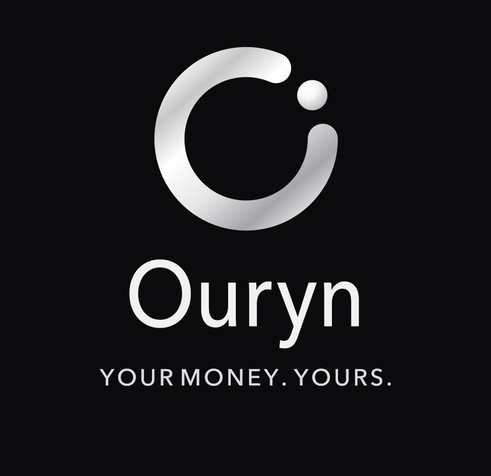
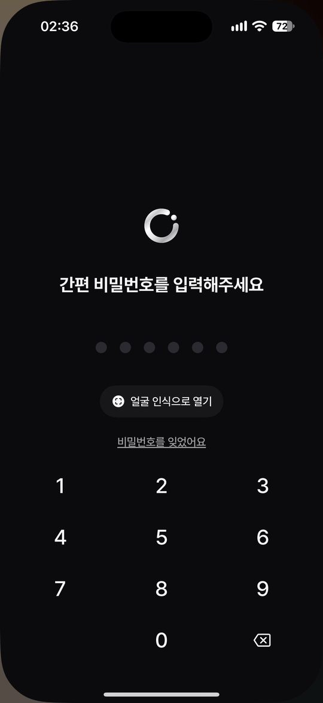
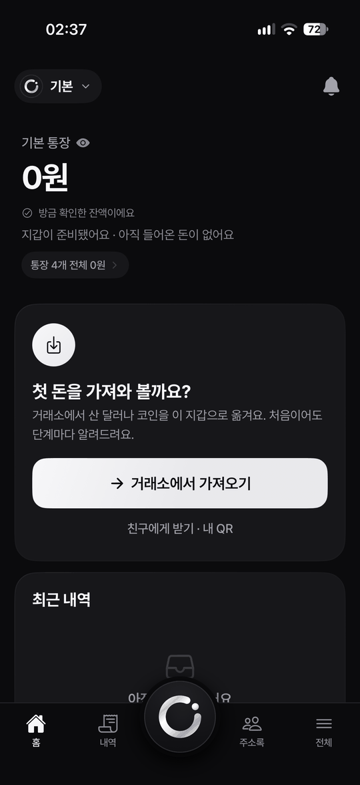
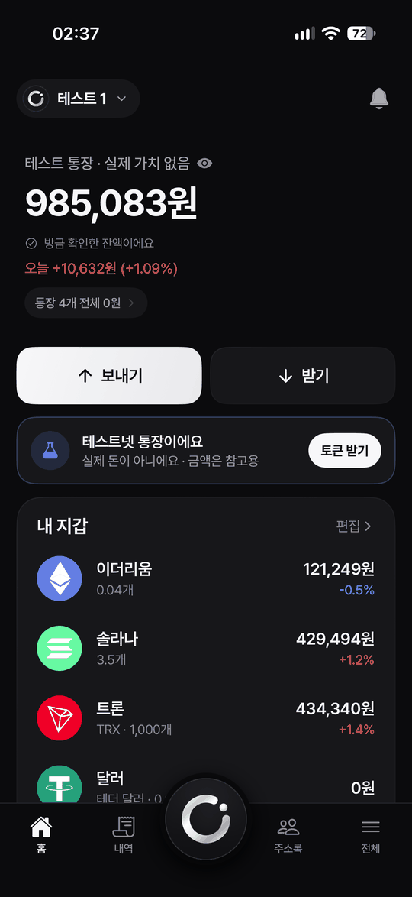
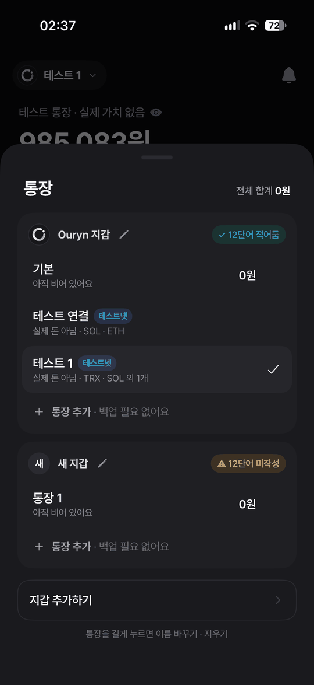
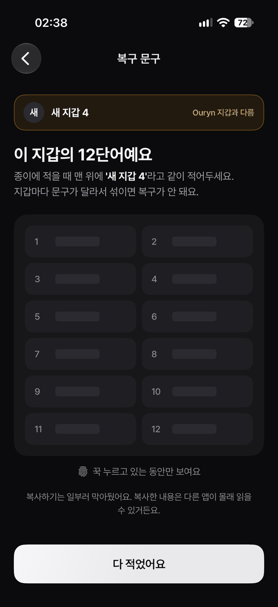
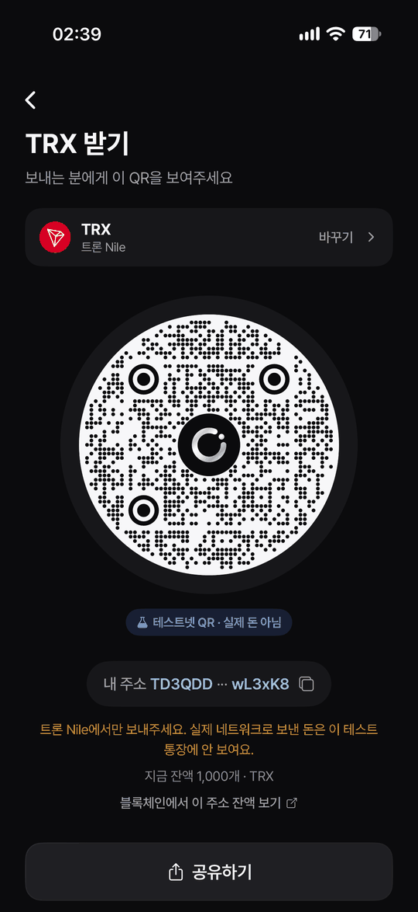
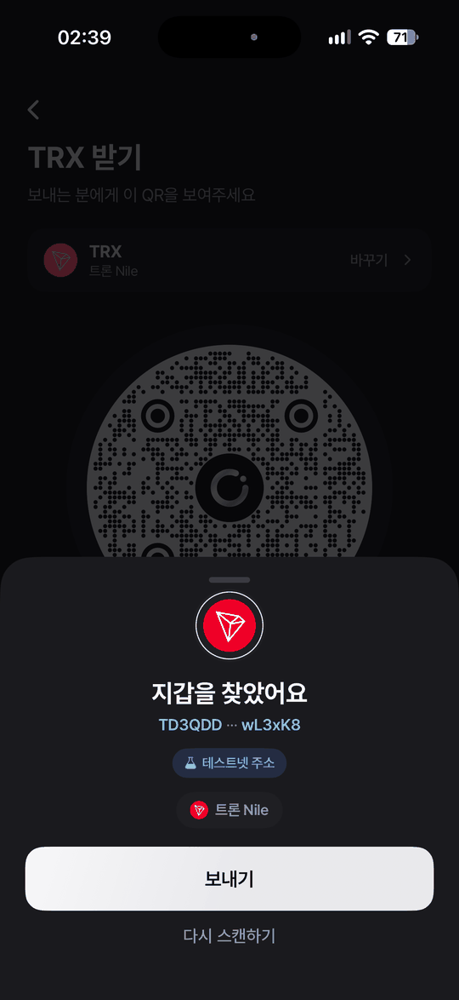
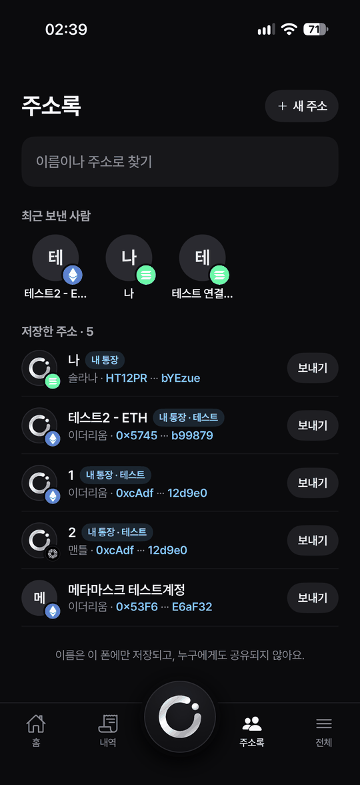

<p align="center">
  
</p>

<p align="center"><b>Your money. Actually yours.</b> — 내 돈의 새로운 일상.</p>

Ouryn은 은행 없이도 내 돈이 온전히 내 것이 되는 **자기수탁(self-custody) 암호화폐 지갑 iOS 앱**입니다. 코인 용어 대신 "내 돈 · 보내기 · 받기"로 말하는 쉬운 화면을 목표로, 스테이블코인(USDC·USDT)을 중심으로 7개 네트워크를 지원합니다.

> **⚠️ 상태: 개발 중 (베타)**
> 보안 감사를 받지 않았고, 메인넷에서 실제 자금으로 입금·송금하는 검증은 아직 하지 않았습니다. 큰 금액을 넣지 마세요. 먼저 앱 안의 **테스트 통장(테스트넷)** 으로 시험하세요.

## 주요 기능

**7개 네트워크** — 받기·보내기·수수료 자산

| 네트워크 | 자산 | 수수료 |
|---|---|---|
| Tron | USDT(TRC-20), TRX | TRX |
| Solana | USDC, USDT, SOL | SOL |
| Ethereum | USDC, USDT, ETH | ETH |
| Mantle | MNT, USDT0 | MNT |
| Avalanche C-Chain | USDC, USDT, AVAX | AVAX |
| Bitcoin | BTC | BTC |
| Cardano | ADA, NIGHT | ADA |

- **받기**: 네트워크·코인별 주소와 QR, 이미지 공유. 점을 원형으로 채운 Ouryn 전용 원형 QR(속은 표준 QR)도 지원합니다.
- **보내기**: 주소 붙여넣기 · 카메라 QR · 앨범 QR. 수수료를 확인한 뒤 기기 본인 인증으로 서명합니다. 최근 보낸 주소와 이름 주소록을 저장합니다.
- **여러 지갑 · 통장**: 지갑은 12단어 하나, 통장은 같은 12단어의 n번째 계정입니다. 다른 앱(Phantom · MetaMask · Trust Wallet · Ledger 방식)의 12단어를 가져올 때 0~4번 계정을 자동으로 찾습니다.
- **테스트 통장**: Solana devnet · Ethereum Sepolia · Avalanche Fuji · Mantle Sepolia · Tron Nile · Bitcoin testnet4 · Cardano preprod. 이 통장에 있을 때만 앱 전체가 테스트넷으로 바뀌고 실제 통장 합계에는 들어가지 않습니다.
- **거래소에서 가져오기**: 출금을 신청하면 해당 자산의 실제 잔액 증가를 15초마다 확인해 도착을 알려 줍니다.
- **결제 모드 / 'Ouryn 결제' 버튼**: 다이나믹 아일랜드(Live Activity)와 제어 센터·동작 버튼(iOS 18+)에서 바로 QR 찍기.

## 실제 앱 화면

실기기에서 찍은 화면입니다. 시험용으로 새로 만든 지갑과 테스트 통장이고, 복구 문구는 가렸습니다.

<table>
  <tr>
    <td align="center"><br><sub>간편 비밀번호</sub></td>
    <td align="center"><br><sub>빈 지갑 홈</sub></td>
    <td align="center"><br><sub>테스트 통장 홈</sub></td>
    <td align="center"><br><sub>지갑 · 통장</sub></td>
  </tr>
  <tr>
    <td align="center"><br><sub>복구 문구 (누를 때만 표시)</sub></td>
    <td align="center"><br><sub>받기 · 원형 QR</sub></td>
    <td align="center"><br><sub>QR 스캔 결과</sub></td>
    <td align="center"><br><sub>주소록</sub></td>
  </tr>
</table>

## 보안 설계

- 키는 영어 12단어(BIP39)로 만들고 **이 기기의 Keychain에만** 저장합니다 (`WhenUnlockedThisDeviceOnly` — iCloud 키체인·백업으로 나가지 않음). 서버로 보내지 않습니다.
- PIN은 평문으로 저장하지 않습니다. salt + PBKDF2-SHA256(10만 회) 해시를 Keychain에 두고, 5회 실패 후 대기 시간이 늘어납니다(30초 → … → 3시간). 실패 횟수도 Keychain에 있어 재설치로 초기화되지 않습니다.
- 앱 전환 화면 가림막, 녹화·미러링 중 12단어 숨김, 복구 문구 입력 시 외부 키보드 차단, 붙여넣은 뒤 클립보드 비우기, 지갑 삭제 전 PIN 확인.
- 시작할 때 표준 테스트 문구(`abandon … about`)로 주소를 계산해 미리 구한 정답과 비교합니다. 틀린 네트워크는 주소를 아예 보여주지 않습니다.
- 서명 전 거래 내용(수신 주소·수량·수수료 상한)을 검증하고, 전파한 거래는 해시와 만료 시점을 저장해 확정·실패·지연을 추적합니다.
- 별도 API 키가 필요 없습니다. 잔액·시세는 공개 엔드포인트(TronGrid, Solana RPC, publicnode, mempool.space, Koios, CoinGecko 등)만 사용합니다.

## 실행 방법

요구 사항: Xcode 16 이상, iPhone(Face ID 등 일부 기능은 실기기에서만 동작)

1. `ios/Ouryn.xcodeproj`를 Xcode로 엽니다. [Trust Wallet Core](https://github.com/trustwallet/wallet-core)(Swift Package, 약 30MB)를 자동으로 받습니다. 안 되면 File → Packages → Resolve Package Versions.
2. 프로젝트 `Ouryn`의 **Signing & Capabilities**에서 `Ouryn`과 `OurynWidgets` 두 타깃 모두 본인 Team을 선택하고, 필요하면 번들 ID를 본인 것으로 바꿉니다.
3. iPhone을 연결해 Run. 처음에는 설정 → 일반 → VPN 및 기기 관리에서 개발자 앱을 신뢰해야 합니다.
4. 전체 탭 → **주소 계산 자체 검사**가 통과인지 먼저 확인하세요.

## 구조

```
ios/
  Ouryn/
    App/          앱 시작, 탭·스택·모달
    Core/         키·주소 파생(Keys), 네트워크·자산 레지스트리, 전송(EVM·Solana·Tron·Bitcoin·Cardano),
                  PIN 보관소, 지갑·통장 저장소, 잔액·시세 조회
    Screens/      화면 (홈, 받기, 보내기, 가져오기, 잠금 …)
    Components/   공통 UI (PIN 패드, QR 스캐너, 12단어 입력 …)
  OurynWidgets/   다이나믹 아일랜드·제어 버튼 위젯 확장
  Shared/         앱·위젯 공용 코드
  Tests/          검증 스크립트와 검증 기록
assets/           로고·코인 아이콘
docs/             구현 검토, 스크린샷
```

## 검증

순수 로직은 Swift 실행 파일로, 기존 흐름은 Python 회귀 검사로, Wallet Core·QR 부분은 DEBUG 시뮬레이터 진단(공개 서명 테스트 벡터 사용)으로 확인합니다. 결과와 한계는 [검증 기록](ios/Tests/Multichain-review.md)과 [구현 검토](docs/multichain-wallet-review.md)에 있습니다. 사용자 복구 문구를 읽거나 사용자 자금으로 시험 전송한 적은 없습니다.

## 알려진 한계 · 다음 계획

- 실기기 소액 입금·송금 검증 전
- 체인 데이터는 공개 서버에 의존합니다(풀 노드 수준의 독립 검증 아님). 출시 전 유료 RPC·자체 노드 검토 예정
- iCloud 암호화 백업 없음 — 현재 유일한 백업은 종이에 적은 12단어
- 백그라운드 도착 알림 없음, 네트워크별 전체 과거 내역 인덱싱 없음
- 트론·카르다노는 거래 기록 대신 잔액만 확인
- 핵심 로직(네트워크·자산 레지스트리, 거래 검증, 미확정 거래 추적)을 Rust 모듈로 분리할 예정입니다. 키 파생·서명은 계속 Wallet Core를 사용하고, UI는 Swift에 남습니다.

## 디자인

브랜드 에셋은 [assets/brand](assets/brand)에 있습니다.

| 파일 | 용도 |
|---|---|
| `ouryn-lockup.svg` | 기본 로고 (열린 O + 워드마크 + 태그라인) |
| `ouryn-lockup-on-dark.svg` · `.png` | 기본 로고를 어두운 바탕에 올린 버전. 밝은 페이지(README 등)용. README에는 선명하게 보이도록 960px PNG를 씁니다 |
| `ouryn-symbol.svg` | 심볼(열린 O)만 |
| `ouryn-wordmark.svg` | 심볼 + 워드마크 가로형 |
| `ouryn-lockup-motion-highlight.svg` | 시작·완료 같은 모션 순간에만 쓰는 하이라이트 버전 |

은색 로고라 흰 배경에서는 글자가 보이지 않습니다. 어두운 바탕에서 쓰세요. 초기 디자인 목업은 [docs/screenshots](docs/screenshots)에 남겨 두었지만, 카드·이자처럼 아직 만들지 않은 화면이 섞여 있어 이 README에는 싣지 않았습니다. 앱의 실제 모습은 위 [실제 앱 화면](#실제-앱-화면)을 보세요.

## 사용한 것

SwiftUI · [Trust Wallet Core](https://github.com/trustwallet/wallet-core) (Apache-2.0) · Pretendard · [cryptocurrency-icons](assets/coins/LICENSE-cryptocurrency-icons.md)
