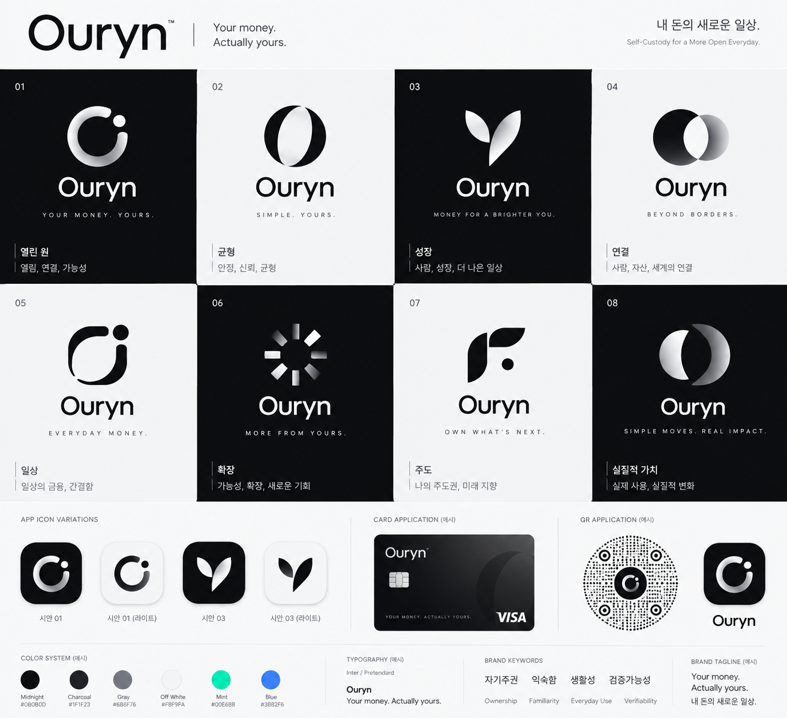
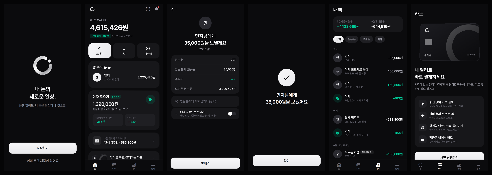

# Ouryn

> **Your money. Actually yours.** — 내 돈의 새로운 일상.

Ouryn은 은행 없이도 내 돈이 온전히 내 것이 되는 **자기수탁(self-custody) 암호화폐 지갑 iOS 앱**입니다. 코인 용어 대신 "내 돈 · 보내기 · 받기"로 말하는 쉬운 화면을 목표로, 스테이블코인(USDC·USDT)을 중심으로 7개 네트워크를 지원합니다.



> **⚠️ 상태: 개발 중 (베타)**
> 보안 감사를 받지 않았고, 메인넷에서 실제 자금으로 입금·송금하는 검증은 아직 하지 않았습니다. 큰 금액을 넣지 마세요. 먼저 앱 안의 **테스트 통장(테스트넷)** 으로 시험하세요.

## 주요 기능

**7개 네트워크** — 받기·보내기·수수료 자산

| 네트워크 | 자산 | 수수료 |
|---|---|---|
| Tron | USDT(TRC-20), TRX | TRX |
| Solana | USDC, USDT, SOL | SOL |
| Ethereum | USDC, USDT, ETH | ETH |
| Mantle | MNT, USDT0 | MNT |
| Avalanche C-Chain | USDC, USDT, AVAX | AVAX |
| Bitcoin | BTC | BTC |
| Cardano | ADA, NIGHT | ADA |

- **받기**: 네트워크·코인별 주소와 QR, 이미지 공유. 점을 원형으로 채운 Ouryn 전용 원형 QR(속은 표준 QR)도 지원합니다. 솔라나 달러는 금액을 넣어 요청할 수 있고, 이 QR은 표준 Solana Pay라 Phantom 등 다른 솔라나 지갑도 금액까지 읽습니다.
- **보내기**: 주소 붙여넣기 · 카메라 QR · 앨범 QR(ERC-681 토큰 송금 요청 포함). 수수료를 확인한 뒤 기기 본인 인증으로 서명합니다. 최근 보낸 주소와 이름 주소록을 저장합니다.
- **여러 지갑 · 통장**: 지갑은 12단어 하나, 통장은 같은 12단어의 n번째 계정입니다. 다른 앱의 12·24단어를 가져올 때 Phantom·MetaMask 방식과 Trust Wallet·Ledger 방식의 0~4번 계정을 확인합니다(아래 '복구 지원 범위').
- **테스트 통장**: Solana devnet · Ethereum Sepolia · Avalanche Fuji · Mantle Sepolia · Tron Nile · Bitcoin testnet4 · Cardano preprod. 이 통장에 있을 때만 앱 전체가 테스트넷으로 바뀌고 실제 통장 합계에는 들어가지 않습니다.
- **거래소에서 가져오기**: 출금을 신청하면 해당 자산의 실제 잔액 증가를 15초마다 확인해 도착을 알려 줍니다.
- **결제 모드 / 'Ouryn 결제' 버튼**: 다이나믹 아일랜드(Live Activity)와 제어 센터·동작 버튼(iOS 18+)에서 바로 QR 찍기.

## 보안 설계

- 키는 영어 12단어(BIP39)로 만들고 **이 기기의 Keychain에만** 저장합니다. 서버로 보내지 않습니다. 저장 방식은 아래 '무엇을 어디에 저장하나'에 정리했습니다.
  - Face ID·Touch ID가 등록된 폰: `WhenPasscodeSetThisDeviceOnly` + 생체인증 ACL(`.biometryAny`). 기기 암호로는 열 수 없고, 기기 암호를 끄면 iOS가 항목을 지웁니다. 생체 보호 저장이 실패하면 보호 없는 저장으로 낮추지 않고 오류로 멈춥니다.
  - 생체인증이 없는 폰: `WhenUnlockedThisDeviceOnly`. 보낼 때 앱 비밀번호를 묻습니다.
  - `ThisDeviceOnly` 항목은 iCloud 키체인으로 동기화되지 않고 **다른 기기로 옮겨지지 않습니다.** 다만 같은 기기의 암호화 백업을 그 기기에 복원하면 돌아올 수 있습니다([Apple 문서](https://developer.apple.com/documentation/security/restricting-keychain-item-accessibility)). '백업에 절대 안 들어간다'는 뜻은 아닙니다.
- PIN은 평문으로 저장하지 않습니다. salt + PBKDF2-SHA256(10만 회) 해시를 Keychain에 두고, 5회 실패 후 대기 시간이 늘어납니다(30초 → … → 3시간). 실패 횟수도 Keychain에 있어 재설치로 초기화되지 않습니다. 대기 시간은 폰 시계와 부팅 뒤 경과 시간 중 짧은 쪽으로 재므로 날짜를 앞으로 돌려도 줄지 않습니다.
- PIN을 10번 틀리면 잠금(hard lock)이 걸립니다. 그 뒤에는 PIN을 맞혀도 보내기·복구 문구 보기·PIN 바꾸기·지갑 지우기·바뀐 Face ID 받아들이기를 할 수 없고, 12단어(또는 등록이 그대로인 Face ID)로 확인해야 풀립니다.
- Face ID로 앱을 열거나 PIN을 다시 정할 때는 인증에 쓴 등록 상태를 그 자리에서 다시 비교합니다. 화면을 띄워 둔 사이 얼굴을 새로 등록해도 통과하지 못합니다.
- 앱 잠금은 앱을 벗어난 지 60초가 지났거나 **그 사이 폰이 잠겼으면** 걸립니다. '앱 열 때 잠그기'·'보낼 때 비밀번호도 확인'을 끄려면 PIN이 필요합니다.
- 복구 문구 화면이나 새 지갑의 12단어를 적는 도중 앱을 벗어나면, 메모리의 단어를 버리고 돌아왔을 때 다시 본인 확인을 받습니다.
- 앱 전환 화면 가림막, 녹화·미러링 중 12단어 숨김(스크린샷은 막지 못하고 찍힌 뒤 경고만 함), 외부 키보드 차단, 붙여넣은 뒤 클립보드 비우기, 지갑 삭제 전 PIN 확인.
- 시작할 때 표준 테스트 문구(`abandon … about`)로 주소를 계산해 미리 구한 정답과 비교합니다. 틀린 네트워크는 주소를 아예 보여주지 않습니다.
- 서명 전 거래 내용(수신 주소·수량·수수료 상한)을 검증하고, 전파한 거래는 해시와 만료 시점을 저장해 확정·실패·지연을 추적합니다. EVM gas 가격이 1000 gwei를 넘으면 견적을 거부하고, 수수료 상한이 지나치게 크면 확인 화면에서 한 번 더 알립니다.
- QR은 뜻을 버리고 읽지 않습니다. ERC-681 `transfer` 요청은 토큰·받는 사람·수량을 그대로 읽고, `approve` 같은 다른 함수·모르는 값·잘못된 체인 번호는 거부합니다.
- 12단어를 아직 적지 않은 진짜 지갑으로 받기 전에는 받기 화면에서 먼저 알립니다.

### 무엇을 어디에 저장하나

| 데이터 | 저장 위치 | 보호 |
|---|---|---|
| 12단어(시드) | Keychain | 위 설명대로 생체인증 ACL 또는 `WhenUnlockedThisDeviceOnly`. 다른 기기로 옮겨지지 않음 |
| 다시 저장하는 동안의 임시 사본 | Keychain | 이미 있던 항목을 바꿀 때만 잠깐 생기고(`WhenUnlockedThisDeviceOnly`), 저장이 끝나면 지움. 실패하면 다음 실행 때 되살림 |
| PIN 해시·실패 횟수·잠금 상태 | Keychain | `WhenUnlockedThisDeviceOnly`. 앱을 지워도 남음 |
| 마지막으로 받아들인 Face ID 등록 상태 | Keychain | `WhenUnlockedThisDeviceOnly` |
| 주소·잔액·거래 내역·이름 주소록·통장 이름·서명된 전파 대기 거래 | UserDefaults(앱 샌드박스) | iOS 샌드박스·기기 암호화만. **앱 PIN으로 따로 암호화하지 않고**, 기기 백업에 들어갈 수 있음. 시드나 개인키는 들어가지 않음 |

### 복구 지원 범위

- 12단어·24단어 BIP39 문구. **비밀 문구(passphrase, 25번째 단어)는 지원하지 않습니다.** passphrase를 쓰던 지갑을 넣으면 다른(빈) 지갑 주소가 나옵니다.
- 솔라나: `m/44'/501'/n'/0'`(Phantom 방식) · `m/44'/501'/n'`(Trust Wallet·Ledger 방식). 이더리움 계열: `m/44'/60'/0'/0/n` · `m/44'/60'/n'/0/0`. 두 방식 중 쓰던 통장이 더 많은 쪽을 가져오고, 다른 방식에서만 보이는 통장이 있으면 화면에 알립니다.
- 비트코인: 통장마다 네이티브 세그윗 첫 받기 주소 `m/84'/0'/n'/0/0` 하나만 봅니다. 다른 받기 주소·거스름돈 주소·다른 주소 유형에 있는 돈은 보이지 않습니다. 카르다노도 첫 주소 `m/1852'/1815'/n'/0/0` 하나만 봅니다.
- 하드웨어 지갑(Ledger 등)의 단어를 폰에 입력하는 것은 하드웨어 지갑 연결과 다릅니다. 하드웨어 격리를 포기하는 일이라 권하지 않습니다.
- 별도 API 키가 필요 없습니다. 잔액·시세는 공개 엔드포인트(TronGrid, Solana RPC, publicnode, mempool.space, Koios, CoinGecko 등)만 사용합니다.

## 실행 방법

요구 사항: Xcode 16 이상, iPhone(Face ID 등 일부 기능은 실기기에서만 동작)

1. `ios/Ouryn.xcodeproj`를 Xcode로 엽니다. [Trust Wallet Core](https://github.com/trustwallet/wallet-core)(Swift Package, 약 30MB)를 자동으로 받습니다. 안 되면 File → Packages → Resolve Package Versions.
2. 프로젝트 `Ouryn`의 **Signing & Capabilities**에서 `Ouryn`과 `OurynWidgets` 두 타깃 모두 본인 Team을 선택하고, 필요하면 번들 ID를 본인 것으로 바꿉니다.
3. iPhone을 연결해 Run. 처음에는 설정 → 일반 → VPN 및 기기 관리에서 개발자 앱을 신뢰해야 합니다.
4. 전체 탭 → **주소 계산 자체 검사**가 통과인지 먼저 확인하세요.

## 구조

```
ios/
  Ouryn/
    App/          앱 시작, 탭·스택·모달
    Core/         키·주소 파생(Keys), 네트워크·자산 레지스트리, 전송(EVM·Solana·Tron·Bitcoin·Cardano),
                  PIN 보관소, 지갑·통장 저장소, 잔액·시세 조회
    Screens/      화면 (홈, 받기, 보내기, 가져오기, 잠금 …)
    Components/   공통 UI (PIN 패드, QR 스캐너, 12단어 입력 …)
  OurynWidgets/   다이나믹 아일랜드·제어 버튼 위젯 확장
  Shared/         앱·위젯 공용 코드
  Tests/          검증 스크립트와 검증 기록
assets/           로고·코인 아이콘
docs/             구현 검토, 스크린샷
```

## 검증

순수 로직은 Swift 실행 파일로, 기존 흐름은 Python 회귀 검사로, Wallet Core·QR 부분은 DEBUG 시뮬레이터 진단(공개 서명 테스트 벡터 사용)으로 확인합니다. Python 검사는 앱 소스에서 실제 코드를 가져와 `swiftc`로 컴파일해 실행하므로 Mac에서 돌립니다.

```bash
for f in ios/Tests/check_*.py; do python3 "$f" || echo "FAIL: $f"; done
```

`check_scan.py`(QR 해석·스캔 전환·ERC-681)와 `check_pin_policy.py`(PIN 10회 잠금·시계 조작)는 [2026년 10월 보안 점검](docs/security-review-2026-10.md) 반영분을 고정합니다. 결과와 한계는 [검증 기록](ios/Tests/Multichain-review.md)과 [구현 검토](docs/multichain-wallet-review.md)에 있습니다. 사용자 복구 문구를 읽거나 사용자 자금으로 시험 전송한 적은 없습니다.

## 알려진 한계 · 다음 계획

- 실기기 소액 입금·송금 검증 전
- 비트코인은 고정 받기 주소 하나를 쓰고 거스름돈도 같은 주소로 돌아옵니다(주소 재사용). 수수료 올리기(RBF)·자식 거래(CPFP)로 멈춘 거래를 구하는 기능은 아직 없습니다
- 입금 기록 일부는 잔액 변화로 만든 것이라 거래 번호가 없고, 여러 입금이 합쳐지거나 시각이 실제와 다를 수 있습니다. 송금 완료는 네트워크별 확정 깊이(이더리움 12블록, 맨틀·비트코인 3블록, 트론 solidified, 솔라나 finalized, 카르다노 3확정)를 확인한 뒤 표시합니다
- 글자 크기 키우기(Dynamic Type)는 아직 반영하지 않았습니다
- 체인 데이터는 공개 서버에 의존합니다(풀 노드 수준의 독립 검증 아님). 출시 전 유료 RPC·자체 노드 검토 예정
- iCloud 암호화 백업 없음 — 현재 유일한 백업은 종이에 적은 12단어
- 백그라운드 도착 알림 없음, 네트워크별 전체 과거 내역 인덱싱 없음
- 트론·카르다노는 거래 기록 대신 잔액만 확인
- 핵심 로직(네트워크·자산 레지스트리, 거래 검증, 미확정 거래 추적)을 Rust 모듈로 분리할 예정입니다. 키 파생·서명은 계속 Wallet Core를 사용하고, UI는 Swift에 남습니다.

## 디자인

브랜드와 화면 목업(더미 데이터)은 [docs/screenshots](docs/screenshots)에 있습니다. 위 화면들은 실제 앱이 아니라 디자인 단계의 목업입니다.



## 사용한 것

SwiftUI · [Trust Wallet Core](https://github.com/trustwallet/wallet-core) (Apache-2.0) · Pretendard (OFL-1.1) · Ionicons (MIT) · [cryptocurrency-icons](assets/coins/LICENSE-cryptocurrency-icons.md) — 자세한 고지는 [THIRD_PARTY_NOTICES.md](THIRD_PARTY_NOTICES.md)

## 보안 문제 제보

공개 이슈 대신 [SECURITY.md](SECURITY.md)의 비공개 제보 방법을 써주세요. 최근 점검과 수정 내역은 [docs/security-review-2026-10.md](docs/security-review-2026-10.md)에 있습니다.
